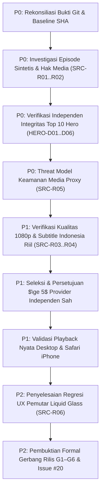

# 04 — Yoru Multi-Source Direct Playback Masterplan (Research Draft)

| Metadata | Nilai |
|---|---|
| Tanggal | 2026-11-04 (Asia/Jakarta) — Revisi 2 (Rekonsiliasi Master Planning) |
| Yomirra | `rzqllh/Yomirra` `preview` @ `e102fbc7484908b5452441cd84938d913856bee6` (metadata only; out of scope) |
| Yoru | `rzqllh/Yoru` `main` @ `464e7a7c46f869675a07c4f2bbf27b8e541bb3af` (historical baseline) |
| Status | **DRAFT - belum di-commit** |
| Banner | **Dokumentasi perancangan & rekonsiliasi teknis. Tidak ada source code, dependensi, atau config yang diubah.** |

---

## 0. Tujuan, Keputusan & Batasan Eksekusi

- **Tujuan Utama:** Yoru menyediakan video langsung di **native web player** (HTTPS HLS `.m3u8`/MP4) **tanpa mengandalkan iframe embed**, dengan target **>=5 provider independen** yang terbukti sah, stabil, dan relevan; memaksimalkan cakupan katalog metadata dan akurasi episode.
- **Pembedaan Metrik Kritis:** Cakupan metadata katalog $\neq$ ketersediaan episode playable. Tidak boleh menjanjikan 100% streaming anime tanpa pengukuran riil.
- **Invarian Mutlak:** D01 (Indonesian-first subtitle priority), D02 (native player fail-closed tanpa fallback iframe), D03 (identity bridge AniList-MAL tanpa migrasi sepihak).
- **Keputusan Owner Terkunci (Dokumentasi):**
  1. Target 5 provider dihitung dari upstream/CDN independen, bukan duplikasi display name pada host yang sama.
  2. Kebijakan D02 dipertahankan ketat: tolak iframe pihak ketiga tanpa kontrol subtitle internal.
  3. Media signed proxy diaudit threat model-nya; aktivasi/ekspansi runtime menunggu persetujuan eksplisit.
  4. Hero Daily Top 10 disajikan dalam kalender Asia/Jakarta (WIB) dengan preservasi timestamp snapshot sumber (JST/UTC).

---

## 1. Evidence Legend

| Label | Arti |
|---|---|
| `VERIFIED` | Terbukti secara empiris melalui file repositori lokal, command exit code 0, atau inspeksi live inspectable |
| `REPORTED_BY_AGY` | Dilaporkan oleh sesi agen sebelumnya; memerlukan verifikasi ulang independen |
| `SOURCE_READ` | Ada fungsi/kontrak pada repositori upstream yang dibaca; bukan bukti live streaming |
| `INFERRED` | Kesimpulan logis berbasis bukti yang ada; belum diuji menyeluruh |
| `PROPOSED` | Usulan arsitektur/kontrak; belum diterapkan dalam runtime |
| `UNKNOWN` | Belum ada data atau pembuktian hak/infrastruktur |
| `BLOCKED` | Terhalang dependensi, perizinan, atau persetujuan eksplisit owner |
| `FAILED` | Pengujian menghasilkan error atau pelanggaran invariant |
| `NOT_RUN` | Belum dieksekusi dalam lingkungan uji |

---

## 2. Inventaris Tujuh Kandidat Asli (SRC-01 s.d. SRC-07)

| ID | Kandidat Asli | Referensi Kode / Extractor | Mekanisme Ekstraksi | Status Bukti | Catatan & Ketergantungan |
|---|---|---|---|---|---|
| SRC-01 | AnimeParadise | `anime-sdk` / `AnimeParadiseProvider.ts` | REST API -> Stream HLS direct | SOURCE_READ + UNKNOWN | Perlu audit CORS, segmen HLS, dan izin siar |
| SRC-02 | HiAnime | `nuvio-anime-providers` / `hianime` | Scraper server -> resolver player | SOURCE_READ + UNKNOWN | Risiko proteksi host megaplay/rapidstream |
| SRC-03 | AnimePahe | `Pal-droid/Animepahe-API` | Extractor MP4/HLS API wrapper | SOURCE_READ + UNKNOWN | Prioritas resolusi 720p/1080p kwik |
| SRC-04 | Otakudesu | `nuvio-anime-providers` / `otakudesu` | Scrape episode -> direct MP4/HLS | SOURCE_READ + UNKNOWN | Format hardsub lokal; rentan domain rotasi |
| SRC-05 | AllManga | `anime-sdk` / `AllmangaProvider.ts` | GraphQL source extraction | SOURCE_READ + UNKNOWN | Obfuscation payload & multi-CDN hosts |
| SRC-06 | Oploverz | `nuvio-anime-providers` / `oploverz` | Episode page -> extractor | SOURCE_READ + UNKNOWN | Dominan MP4/hardsub; resolusi bervariasi |
| SRC-07 | Gomunime | `nuvio-anime-providers` / `gomunime` | Scrape link -> resolver | SOURCE_READ + UNKNOWN | Ketergantungan host pihak ketiga |

---

## 2B. Ekosistem Agregator & Ekstensi Komunitas (5 Taksonomi)

| Kategori | Nama Ekosistem / Proyek | Peran Arsitektur & Pelajaran untuk Yoru | Status Klasifikasi |
|---|---|---|---|
| **1. Provider Candidate** | AnimeParadise, HiAnime, Otakudesu, Oploverz, Gomunime, AllAnime | Sumber upstream potensial yang diekstrak langsung ke format HLS/MP4. | CANDIDATE |
| **2. Aggregator API** | Tatap, Aniraku Backend, Anivexa (Ani-API), Anihub API, lightanime-api | Layanan pengumpul multi-provider headless; referensi contract federation & route fallbacks. | ARCH_REFERENCE |
| **3. Implementation Ref** | StreamPlay, Tatakai, Shisen (`StreamResolver.java`) | Implementasi extractor native Android/Node; referensi parsing manifest & handling headers. | ARCH_REFERENCE |
| **4. Extension Framework** | CloudStream, Aniyomi, Mangayomi, Seanime | Model plugin scraper modular terisolasi; arsitektur sandbox pencegah runtuhnya app utama. | ARCH_REFERENCE |
| **5. Architectural Inspo** | Unified Provider Interface, Singleflight Cache, Health Circuit Breaker | Pola fail-closed D02, de-duplikasi request paralel, dan isolasi kegagalan provider. | PROPOSED |

*Invariant Kelayakan:* Aggregator API yang mengekstrak CDN yang sama dengan provider langsung tidak boleh dihitung ganda sebagai 2 provider independen.

---

## 3. Audit Kritis Implementasi Lokal (SRC-R01 s.d. SRC-R06)

### SRC-R01 — Synthetic Episode Availability Risk
- **Temuan:** Pembuatan daftar episode sintetis otomatis dari metadata (misal mengasumsikan 12 episode bila count null) memicu status "Play-Ready" palsu pada anime belum tayang (*unreleased*), cour berbeda, atau movie.
- **Mitigasi:** Episode hanya boleh disematkan status `registered`/`candidate` jika provider merespons episode ID nyata. Anime unreleased wajib berstatus `unavailable`.

### SRC-R02 — Universal Mirror Stream Validity
- **Temuan:** Resolver fallback universal yang memasukkan stream embed tanpa subtitle native melanggar D02 fail-closed dan menampilkan pesan degradasi membingungkan pada anime 38000/61987.
- **Mitigasi:** Pengecekan ketat format stream: hanya terima HTTPS direct HLS/MP4. Iframe embed dilarang menjadi sumber native default.

### SRC-R03 — Real 1080p Quality Verification
- **Temuan:** Label "1080p" tidak boleh sekadar string statis pada respons JSON.
- **Mitigasi:** Kualitas diverifikasi melalui atribut `RESOLUTION=1920x1080` pada HLS variant manifest atau `videoWidth`/`videoHeight` pada MP4 terdekode di browser. Jika hanya tersedia 720p/480p, laporkan secara transparan.

### SRC-R04 — Subtitle Language Integrity & Foreign Hardsub Leak
- **Temuan:** Insiden pada anime Shingeki no Kyojin (16498) di mana antarmuka memilih "Bahasa Indonesia", namun video streaming memuat hardsub bahasa Arab gundul (cera.online) tanpa trek VTT yang cocok.
- **Mitigasi:** Validasi trek subtitle: pisahkan video raw dari softsub VTT Indonesia. Deteksi hardsub asing dan tolak sebagai kandidat audio asli/subtitle Indonesia.

### SRC-R05 — Media Proxy Security & SSRF Threat Model
- **Temuan:** Endpoint proxy media (`backend/api/proxy.ts`) berisiko menjadi open-proxy atau vektor SSRF jika host target tidak dibatasi ketat.
- **Mitigasi Threat Model:**
  1. *Host Allowlisting:* Hanya host CDN terverifikasi yang diizinkan.
  2. *Anti-SSRF:* Tolak IP loopback (`127.0.0.1`), link-local (`169.254.0.0/16`), private subnet (`10.0.0.0/8`, `192.168.0.0/16`), dan protokol selain HTTPS.
  3. *Token Binding & TTL:* Token proxy ditandatangani HMAC dengan TTL maksimal 3 jam dan parameter anime/episode terikat.
  4. *Anti-Circumvention:* Dilarang membypass proteksi DRM, otorisasi berbayar, atau geoblocking terenkripsi.

### SRC-R06 — Native Player UX & Subtitle Overlap
- **Temuan:** Panel kontrol Liquid Glass terlalu tinggi sehingga menutupi teks subtitle (2–3 baris) di bagian bawah; kontrol mengecilkan ukuran video (*aspect-ratio letterboxing distortion*); safe-area mobile belum optimal.
- **Mitigasi:** Restrukturisasi CSS layout pemutar: naikkan baseline rendering subtitle WebVTT saat controls overlay aktif, optimalkan backdrop blur, dan sesuaikan tombol transport untuk sentuhan mobile (min 44px).

---

## 4. Track Integritas Data Hero Top 10 Harian (HERO-DATA)

### HERO-D01 — Metrik Ranking Riil AniList
- Metrik peringkat adalah `trend.trending` dari GraphQL `Page.mediaTrends` AniList pada snapshot harian aktif, **bukan** skor rata-rata all-time (`averageScore`) dan **bukan** popularitas sepanjang masa (`popularity`).
- Peringkat merefleksikan lonjakan aktivitas komunitas harian, sehingga anime skor 7.6 (misal *Overgeared*) dapat sah berada di peringkat #1 mengalahkan anime legenda skor 9.0+.

### HERO-D02 — Zona Waktu, Kalender Asia/Jakarta & Snapshot
- AniList mempublikasikan snapshot harian pada 15:00 UTC (tepat 00:00 JST / 22:00 WIB).
- Normalizer memetakan snapshot ke kalender lokal Asia/Jakarta (`2026-11-03` / `2026-11-04`). Preservasi tanggal aktual snapshot dalam cache; dilarang memalsukan tanggal hari ini bila menggunakan snapshot stale.

### HERO-D03 — Pemisahan Sumber Data (No Masking)
- Jika snapshot harian AniList tersedia: Tampilkan badge `#1 HARI INI` dan `TREN HARIAN ANILIST` beserta tanggal snapshot resmi.
- Jika API AniList gagal/offline: Fallback ke katalog MyAnimeList diberi label jujur `#1 TERPOPULER` dan `POPULER SEPANJANG MASA`. Dilarang memalsukan all-time popularity sebagai tren harian.

### HERO-D04 — Kelengkapan & Deduplikasi Peringkat
- Ambil tepat 10 anime unik per snapshot harian.
- Deduplikasi duplikat `idMal` pada snapshot yang sama (mempertahankan peringkat lonjakan tertinggi).
- Filter ketat anime dewasa (`isAdult: true`) dan anime tanpa mapping `idMal`. Jika kandidat $< 10$, lemparkan `INSUFFICIENT_DATED_TRENDS` (fail-closed, jangan mengarang filler).

### HERO-D05 — Pemisahan Timer Carousel 10s dari Fetching
- Rotasi visual hero berjalan pada interval **10 detik** (`setInterval`) murni memanipulasi state indeks (`setFeaturedIndex`), **tanpa memicu network request**.
- Navigasi manual (klik tab rank #1..#10 atau panah keyboard) otomatis me-reset timer rotasi 10 detik.
- Rotasi otomatis jeda saat di-hover, difokuskan (a11y), disentuh pada mobile, tab browser tidak aktif, atau mode `prefers-reduced-motion`.

### HERO-D06 — Independent QA & Bukti Deterministik
- Suite pengujian [`tests/daily-trends.test.mjs`](file:///C:/Users/Hafizh%20Rizqullah/Documents/Code/_active/Yoru/tests/daily-trends.test.mjs) memuat 6 uji deterministik membuktikan ranking murni dari lonjakan aktivitas harian, deduplikasi ID, penolakan tren tidak lengkap, dan preservasi tanggal snapshot.

---

## 5. Tata Kelola Multi-Agent XYN & Alokasi Peran

| Agen / Spesialis | Peran & Tanggung Jawab | Output & Deliverable |
|---|---|---|
| **Ritsuka Xyn** | Controller tunggal, orkestrasi bukti, sintesis laporan akhir | Pengendalian alur, penegakan batasan, resolusi konflik bukti |
| **Fuyuka Xyn** | Riset ekosistem agregator, lisensi, dan kontrak pihak ketiga | Taksonomi 5 kategori agregator, audit lisensi publik |
| **Miori Xyn** | Arsitektur multi-source federation & modul failover | Desain pipeline federasi dan state machine ketersediaan |
| **Kanade Xyn** | Backend pipeline, resolver stream, dan fallback state | Analisis `universal.ts`, `indonesia.ts`, `daily-trends.ts` |
| **Kotone Xyn** | Kontrak API, normalisasi identitas AniList-MAL | Skema endpoint, verifikasi parameter, validasi ID |
| **Hibiki Xyn** | Frontend UI, perbaikan UX pemutar Liquid Glass, carousel 10s | Audit tumpang tindih subtitle, safe-area mobile, timer reset |
| **Sae Xyn** | Security review signed media proxy & batasan SSRF | Threat model anti-SSRF, DNS rebinding, token TTL |
| **Fumika Xyn** | Integrasi paket 12 berkas draf dokumentasi | Konsistensi format markdown, batasan ukuran, keterlacakan |
| **Reika Xyn** | Audit konsistensi kode dan arsitektur repositori | Review keselarasan arsitektur masterplan vs kode lokal |
| **Rinne Xyn** | QA audit independen (Maker-Checker Gate) | Verifikasi bukti, evaluasi adversial, penolakan klaim palsu |

---

## 6. Roadmap Eksekusi Rekayasa Berbasis Dependensi

### Rincian Paket Kerja Roadmap:
- **P0 — Fondasi Integritas & Keamanan (Blokir Eksekusi Jika Belum Lolos):**
  - `WP-P0-01`: Rekonsiliasi baseline SHA `464e7a7c` vs local dirty working tree.
  - `WP-P0-02`: Investigasi kegagalan ketersediaan episode sintetis & validitas mirror (SRC-R01, SRC-R02).
  - `WP-P0-03`: Verifikasi data pipeline AniList tren harian, zona waktu JST/WIB, dan larangan masking all-time (HERO-D01..D06).
  - `WP-P0-04`: Audit keamanan media proxy: pencegahan SSRF, DNS rebinding, allowlist host, dan token expiry (SRC-R05).
- **P1 — Validasi Media Riil & Seleksi 5 Provider:**
  - `WP-P1-01`: Pengukuran resolusi 1080p riil via stream inf & inspeksi trek subtitle Indonesia murni (SRC-R03, SRC-R04).
  - `WP-P1-02`: Seleksi dan audit ToS/infrastruktur $\ge 5$ provider independen tanpa shared CDN tersembunyi.
  - `WP-P1-03`: Pengujian playback fisik Chromium desktop dan WebKit Safari iOS.
- **P2 — UX Polishing & Kesiapan Rilis:**
  - `WP-P2-01`: Perbaikan layout kontrol pemutar Liquid Glass agar tidak menutupi subtitle WebVTT (SRC-R06).
  - `WP-P2-02`: Penyusunan audit trail lengkap untuk gerbang rilis publik G1–G6 dan penutupan issue #20.

---

## 7. Extended Acceptance Matrix (AC-SRC-MULTI & AC-HERO)

| Acceptance ID | Deskripsi Persyaratan | Bukti Wajib untuk Status PASS | Status Saat Ini |
|---|---|---|---|
| `AC-SRC-MULTI-01` | $\ge 5$ provider independen yang sah dan tidak berbagi CDN upstream yang sama | Audit register ditandatangani owner + dependency graph CDN | PROPOSED / NOT_RUN |
| `AC-SRC-MULTI-02` | Fail-closed D02: tidak ada iframe pihak ketiga yang dianggap native playable | Validasi parser format HLS/MP4 dan penolakan iframe embed | LOCKED INVARIANT |
| `AC-SRC-MULTI-03` | Pencocokan akurat season, cour, OVA, movie tanpa episode sintetis | Test suite fixture lintas anime multi-season (Attack on Titan, Haruhi, Fate) | PROPOSED / NOT_RUN |
| `AC-SRC-MULTI-04` | Resolusi 1080p terukur pada master playlist/MP4, bukan string statis | Ekstraksi manifest `STREAM-INF` / browser decoded video properties | PROPOSED / NOT_RUN |
| `AC-SRC-MULTI-05` | Subtitle Bahasa Indonesia murni tanpa kebocoran hardsub asing (Arab gundul) | Validasi WebVTT, cue timing synchronization, dan deteksi hardsub | PROPOSED / NOT_RUN |
| `AC-SRC-MULTI-06` | Media signed proxy aman dari SSRF, DNS rebinding, dan akses internal | Test suite penetrasi SSRF, IP blacklist, dan token HMAC expiration | PROPOSED / NOT_RUN |
| `AC-HERO-01` | Peringkat harian didasarkan pada lonjakan delta aktivitas AniList harian riil | Assertions pada `tests/daily-trends.test.mjs` membuktikan show skor rendah rank #1 | VERIFIED LOCAL / AGY |
| `AC-HERO-02` | Preservasi tanggal snapshot kalender Asia/Jakarta tanpa fabrikasi tanggal stale | Uji timestamp 15:00 UTC -> tanggal kalender lokal dan preservasi cache stale | VERIFIED LOCAL / AGY |
| `AC-HERO-03` | Pemisahan tegas label fallback: `#1 TERPOPULER` bila offline, bukan `#1 HARI INI` | Unit/E2E test simulasi HTTP 503 AniList menghasilkan label katalog all-time | VERIFIED LOCAL / AGY |
| `AC-HERO-04` | Rotasi carousel 10 detik terisolasi dari network fetch + reset pada aksi manual | E2E browser test menguji timer reset dan ketiadaan network calls saat tick | VERIFIED LOCAL / AGY |

---

## 8. Keputusan Owner yang Dibutuhkan untuk Fase Implementasi Kode

1. **Persetujuan Daftar Provider Definitif:** Apakah daftar 5 provider terpilih disetujui untuk diintegrasikan pada fase runtime P1?
2. **Persetujuan Skema Proxy Signed:** Apakah deployment proxy internal diizinkan untuk stream yang memerlukan custom header/CORS, dengan batas SSRF yang diaudit?
3. **Penyelarasan Desain Subtitle Pemutar:** Apakah penaikan baseline subtitle (padding bottom 96px pada controls active) disetujui untuk diterapkan pada `Player.tsx`?
4. **Izin Branching / Worktree:** Apakah implementasi kode akan dilakukan pada branch terpisah sebelum digabungkan ke `main`?

---

## 9. Status Dokumen & Batasan Tindakan

Dokumen ini adalah **DRAFT PERANCANGAN (PLANNING PROPOSAL)**. Tidak ada implementasi runtime, instalasi paket, bypass DRM, scraping langsung, atau deployment produksi yang dilakukan dalam penugasan ini. Seluruh modifikasi kode ditunda hingga persetujuan fase berikutnya.
