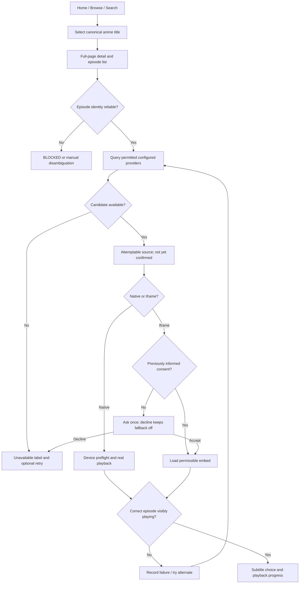
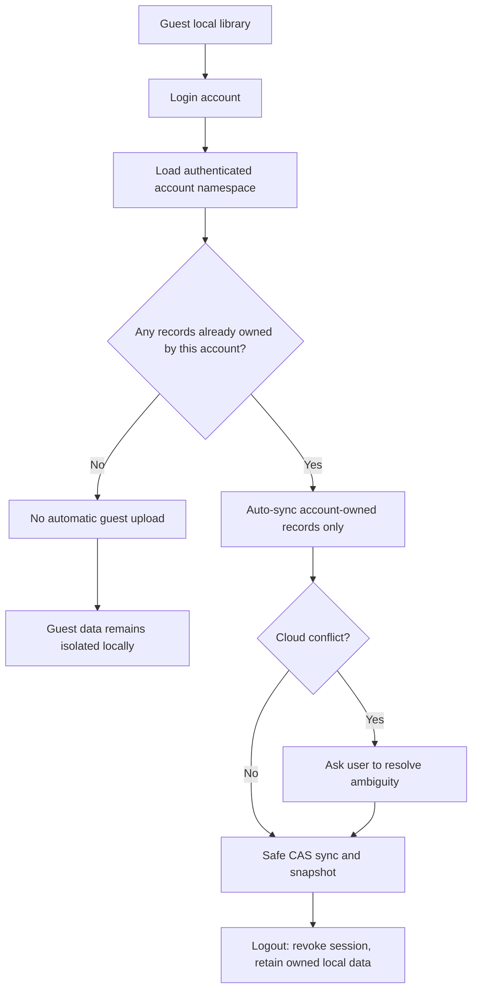
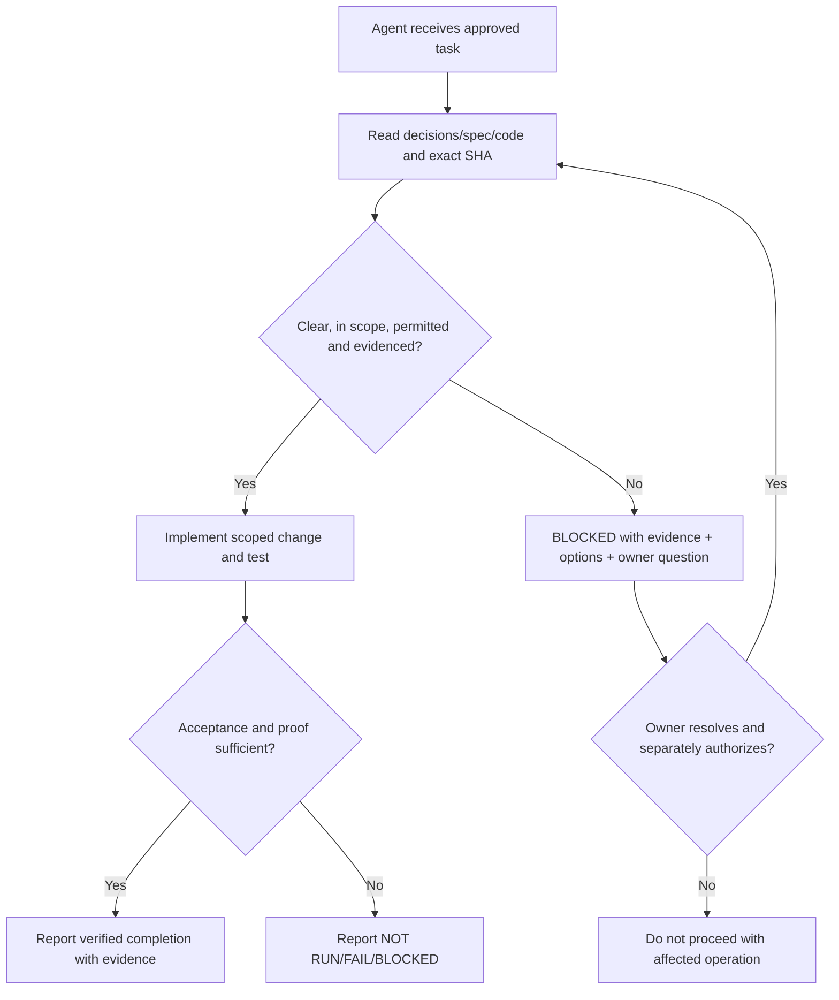

# 05 — End-to-End User Flows

**Status:** Proposed user journey contract. Source implementation varies. See [PRD](01-PRD.md), [Design](02-DESIGN.md), [Business Rules](06-BUSINESS_RULES.md), and [Testing](12-TESTING.md).

## UF-01 Discover → Detail → Play

**Invariants:** discovering an URL never means success; episode/season/cour matched before playback; iframe does not gain unsupported native controls. Provider/access restrictions cannot be bypassed.

## UF-02 Subtitle lifecycle

1. On native playback, read persistent preferred language/Off state; do not override Off.
2. Search local tracks and authorized subtitle federation independently of video provider.
3. If confidently matched Indonesian track exists, select it. If ambiguous, present candidates for user choice.
4. If only English exists, ask explicit permission **before** switching.
5. If neither available, keep playback possible and label no subtitle; allow validated manual subtitle import if supported.
6. For hardsub, mark text embedded in video; disable Off/resize for hard track.
7. If embed cannot expose external subtitle controls, state controls are inside third-party player if available; do not fake toggles.
8. Save subtitle preferences/offset and ensure episode switches do not silently turn Off back on.

**Error paths:** 401/403 credential or permission issue, 429 quota, timeout, wrong release, file malformed, browser renderer unsupported. All are surfaced without showing raw tokens/private links.

## UF-03 Continue Watching and Auto-next

1. Read progress only from active guest/account namespace.
2. Resume exact anime and numbered/identified episode with last timestamp; revalidate candidate video.
3. If source missing or wrong, preserve progress and offer alternate or retry; never jump to another anime to appear successful.
4. On completed native episode, look up **verified correct next episode** (not merely arithmetic increment across season/OVA).
5. After next episode source verified, start an **8-second countdown** with Cancel; otherwise show unavailable status.
6. On owner-approved fallback iframe, unsupported progress/auto-next controls remain disabled/explained.

## UF-04 Guest → Login → Sync → Logout

Guest data is never silently claimed. If ownership cannot be established, the action is `BLOCKED` for that record until explicit claim/import workflow and authorization exist. Account A/B data must not mix even on shared devices.

## UF-05 Backup / restore / account deletion

- **Export:** validate local schema, redact secrets; export only currently authorized ownership domain; mark version and timestamp.
- **Import:** inspect version, owner identity, record limits, canonical ID, corruption/duplicates; offer preview before mutation where required. Failed import leaves existing library untouched.
- **Snapshot restore:** choose timestamped version; conflict-resolution and integrity guard; preserve newer data via safe merge or explicit user choice.
- **Logout:** session removed, owned local data retained (P46), guest data still isolated.
- **Delete account:** explicit confirmation, cloud deletion and retention semantics per approved policy; never treat logout as delete.
- **Unknown ownership:** no delete, merge or upload by guess.

## UF-06 Browse/filter, upcoming and Watch Guide

- Browse search parameters are URL-backed, validated and compatible with browser history.
- Primary filters visible; advanced expandable. Show loaded count vs total count honestly; no 100% claim based on incomplete page set.
- Upcoming is an explicit discovery destination, excluded from first-public-release required playable denominator (RG07).
- Watch Guide uses reviewed curated route if available, otherwise release order, with separate edition and spoiler annotations. Missing chronology evidence → do not invent chronology.

## UF-07 Local QA → one production deployment

1. Owner approves the engineering scope.
2. Inspect local repository/worktrees/exact SHA and reconcile [L01](../planning/owner-freeze-2026-11-15/DECISION_REGISTER.md).
3. Run local dev/production build with local/test data. No hosted preview/staging or automatic production credential import.
4. Run unit, contract, security negatives, browser automated tests; manually test authorized media, live subtitles, physical iPhone Safari and desktop Chrome as required.
5. Report PASS/FAIL/NOT RUN/BLOCKED with proof. Missing or contradictory evidence must be reported; do not promote.
6. Reviewer approves merge separately; owner approves production deploy/release separately.
7. Deploy only to production, monitor exact SHA, maintain rollback plan. Public release remains NO-GO until [#20](https://github.com/rzqllh/Yoru/issues/20) gates close.

## UF-08 Agent/harness blocked-state flow

**Blocker record:** `YOR-BLK-###`, affected requirement/decision IDs, evidence path/SHA, unknown, impact, safe alternatives, recommendation, precise owner decision needed. Never manufacture an answer for the owner.
