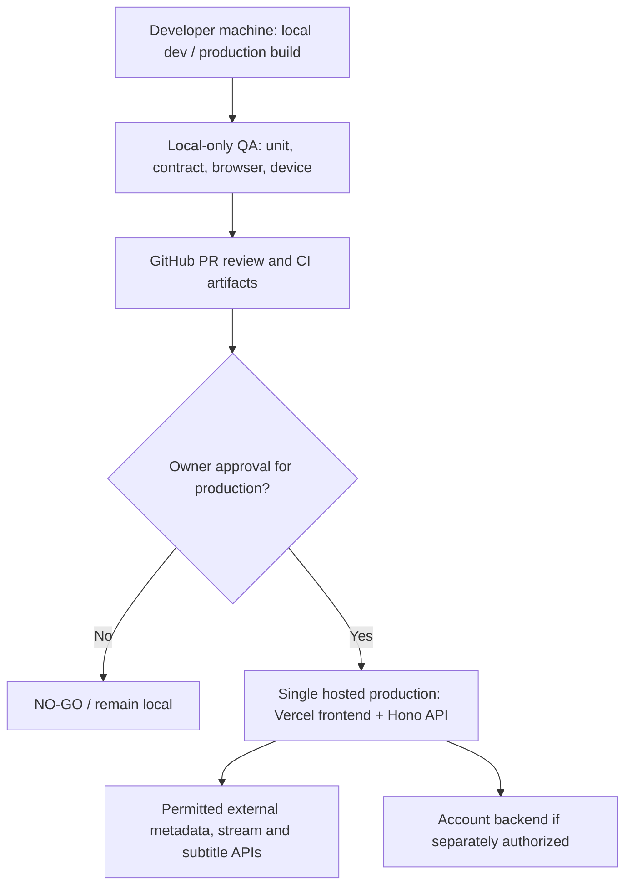
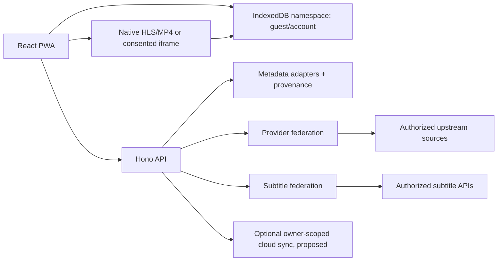

# 09 — System Architecture and Decision Boundaries

**Status:** Historical observed topology + approved owner target separated. `PROPOSED` does not indicate existing code. [L01](../planning/owner-freeze-2026-11-15/DECISION_REGISTER.md) is the most recent deployment decision. See [API](08-API.md), [Database](07-DATABASE.md), [Security](10-SECURITY.md).

## 1. Observed technical stack (inspected code, not runtime deployment proof)

| Layer | Code/location | Role |
|---|---|---|
| Frontend | React + TypeScript + Vite in `frontend/`, `App.tsx`, `Player.tsx` | Home, Browse, detail, source choice, player, captions |
| Client persistence | `idb` IndexedDB, `db.ts`, `backup.ts` | Local library, resume, preferences, v1 manual backup |
| Service worker | `frontend/public/sw.js` | Offline app shell; current code avoids caching /api calls |
| Backend | Hono in `backend/api/app.ts` | Catalog/metadata, provider federation, subtitles, health |
| Metadata | `backend/pipeline/jikan.ts`, `catalog-sources.ts`, AniList helpers | Tenrai/Jikan MAL metadata and selected AniList enrichment |
| Providers | `backend/providers/local.ts`, `stremio.ts`, `miruro.ts`, `public-embed.ts` | Candidate source resolution; not proof of licensed playable videos |
| Subtitle adapters | `backend/providers/subtitles.ts` | SubDL, SubSource, OpenSubtitles, Stremio, signed grants |
| Adapter | `api/index.ts`, `vercel.json` | Vercel-compatible Hono function and SPA rewrite |
| Tests | `tests/`, `tests/browser/`, workflows | Node tests and browser test fixtures; live/device separate |

**Do not replace React/Vite with Next.js, introduce a new server framework, change database vendors or install architecture dependencies as a documentation side effect.** Such changes require separate owner authorization and evidence.

## 2. Target runtime topology — L01

- **Only production is deployed remotely.** No hosted preview site, Vercel branch preview, remote staging project or automatic Git deploy.
- Local runs use local/test fixture data. Do not connect developer preview to real production users or service-role database credentials without separate explicit authorization.
- Current `vercel.json` has `git.deploymentEnabled=false`; actual hosting configuration and historical manual previews were **not verified**, so no claim they were deleted.
- A reviewed PR, CI artifact or local screenshot is not production deployment. Production deploy and rollback need owner GO; release #20 remains NO-GO.

## 3. Target domain boundaries

Proposed clean contracts (not invented current interfaces):

- **Identity module:** canonical anime/edition/episode IDs + MAL/AniList/provider mappings with provenance and ambiguity state.
- **Metadata module:** per-field authority and cached stale/source labels. If AniList cannot legally be used, keep associated functionality BLOCKED while preserving data and safe fallbacks; owner RG10 doesn't override ToU.
- **Provider module:** registry, capability probing, source candidate → attemptability → observed success, ranking, health/cooldown, failover, disable-only switch.
- **Subtitle module:** release/season/episode matching, permission, signed grants, browser render support.
- **Playback UI:** controls gated by native vs iframe/hardsub support; actual decoder evidence; progress persistence.
- **Account module:** guest/account namespaces, OTP/RLS/CAS/versioned snapshot once separately approved and verified.
- **Coverage ledger:** independent eligible catalog and episode denominator with verified playback numerator; **BLOCKED C02 until P68 reconciled**.

## 4. Data and source flows

**Catalog:** typed source → normalization and per-field provenance → internal ID → Browse/detail → cached/readable offline state where supported.

**Episode:** metadata episode identity → adapter identity map → source candidate and provider ID → safe preflight/user opt-in → real playback and result evidence. Never join source only by episode number/title. Public embed can be a separately consented fallback with verified correct content, not assumed native.

**Subtitle:** player episode context → backend federated search → confidence and language/permission check → signed safe file delivery → local caption rendering or truthful unavailable/iframe limitation.

**Sync (PROPOSED):** authenticated account ID → local account-owned records → CAS/revision + owner RLS → versioned recovery; guest records stay isolated. External cloud backend must not appear in local previews as production-data access by default.

## 5. Reliability and scalability contract

- Provider fan-out bounded and independent; one 429/timeout doesn't fail healthy peers. Record source health without personal watch events (P34/P43/P65).
- Cache should have bounds and provenance. Browser service worker must not indiscriminately cache authenticated APIs or protected media URLs.
- Upstream requests must have allowlisted host, DNS/IP/redirect/size/timeout protections; no arbitrary proxy.
- API limits and budgets must work across actual deployed instances (process-local state alone is not a production guarantee). Design and test before production authorization.
- Cloud data uses least-privilege credentials, RLS negative tests, backup, CAS and explicit data owner.
- Critical incidents: preapproved narrow provider disable-only switch permitted (P69); production rollback owner-approved.
- Make failure and fallback observable without leaking signed URLs/tokens/history.

## 6. Architecture decision log

| ADR ID | Decision | Status |
|---|---|---|
| ADR-01 | React/Vite PWA + Hono backend retained | Observed/current |
| ADR-02 | Production only hosted, local-only preview | **L01 chosen** |
| ADR-03 | Built-in/configured providers, native first, verified consented iframe fallback | Chosen; code mismatch |
| ADR-04 | MAL/AniList hybrid per-field authoritative metadata | Owner-chosen, upstream eligibility blocked |
| ADR-05 | Optional account, account-owned auto sync, guest isolation | Owner-chosen, unimplemented cloud |
| ADR-06 | Public 100% all already-aired eligible catalog playback | Owner-chosen, denominator blocked |
| ADR-07 | FlyStream architectural study only | RG01 chosen |
| ADR-08 | Torrent engine deferred | P05 chosen |
| ADR-09 | Provider kill switch disable-only with audit | Owner-chosen, not verified |

## 7. Architecture change gate

Before changing source, provider transport, database, runtime/hosting, shared model or client router: record exact current SHA and design impact, alternatives, data migration/rollback, security/rights, test plan, approval owner. If a new system component is necessary but unsanctioned, stop `BLOCKED` and ask. Do not invent compatibility between Safari and a provider/ExoPlayer just because third-party architecture exists.
